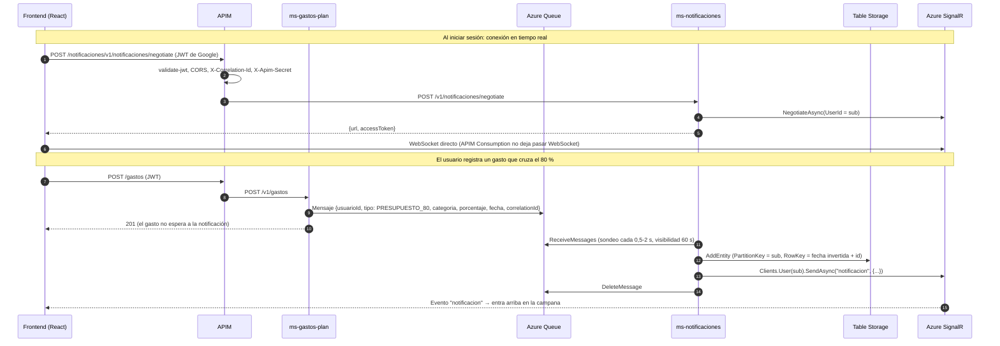

# ms-notificaciones

Microservicio de notificaciones de **EstudiAmbre** (Diseño de Software, Fase II).
.NET 10 · Azure Queue Storage · Azure Table Storage · Azure SignalR (modo Serverless).

```
ms-gastos-plan ──evento──► Queue "eventos-presupuesto" ──► ConsumidorColaWorker
                                                             │
                                       Table Storage ◄───────┤ guarda
                                       Azure SignalR ◄───────┘ envía al usuario (sub)
                                             │
React (campana) ◄──WebSocket directo──────────┘
React ──APIM──► GET/PATCH /v1/notificaciones, POST /v1/notificaciones/negotiate
```

## Endpoints

Todos bajo `/v1`, con `Authorization: Bearer <Google JWT>` (APIM valida la firma; aquí solo se lee `sub`).

| Método | Ruta | Respuesta |
|---|---|---|
| GET | `/notificaciones?page=0&size=10[&leida=false]` | `{content, page, size, totalElements, totalPages}`, de la más nueva a la más vieja. `size` 1–50. Con `leida=false` (o `true`) filtra, y los totales cuentan solo las filtradas |
| POST | `/notificaciones` | Body `{tipo?, titulo, mensaje, categoria?}` → 201 con la notificación. También la envía en vivo (útil para Postman) |
| PATCH | `/notificaciones/{id}` | Body `{"leida": true}` → 200 con la notificación. Otro campo → 400. De otro usuario → 404 |
| DELETE | `/notificaciones/{id}` | 204 siempre (idempotente: si no existe o es de otro usuario, no se borra nada y no se revela si existe) |
| GET | `/notificaciones/push/clave` | `{clavePublica}`: clave pública VAPID para que el navegador se suscriba. 503 si no hay claves |
| POST | `/notificaciones/push/suscripciones` | Body = `PushSubscription.toJSON()` (`{endpoint, keys:{p256dh, auth}}`) → 204. Endpoint que no sea de un servicio de push conocido → 400 |
| POST | `/notificaciones/push/suscripciones/baja` | Body `{endpoint}` → 204 (idempotente) |
| POST | `/notificaciones/negotiate` | `{url, accessToken}` para conectarse a Azure SignalR. 503 si no hay SignalR configurado |
| GET | `/health`, `/swagger` | Sin autenticación ni certificado |

Notificación: `{id, tipo, titulo, mensaje, leida, fecha, categoria?}` (fecha en Epoch ms, UTC). `categoria` viene en las que nacen de un evento de presupuesto (la categoría del plan); si no hay, el campo no se envía.
Errores: `{status, message, correlationId}`. Toda respuesta trae `X-Correlation-Id`.

## Contrato con Gastos y Plan (evento en la cola)

Cola `eventos-presupuesto` en la misma Storage Account. Mensaje en **JSON plano** (se acepta también Base64):

```json
{"usuarioId":"<sub>","tipo":"PRESUPUESTO_80","categoria":"Comida","porcentaje":82.5,"fecha":1794700000000,"correlationId":"..."}
```

- `tipo`: `PRESUPUESTO_80` o `PRESUPUESTO_100`. Otro valor → el mensaje va a `eventos-presupuesto-poison`.
- `porcentaje`: número de 0 a 100+ (no fracción). `fecha`: Epoch ms (si viene en segundos, se convierte).
- `usuarioId`: el `sub` del JWT de Google, el mismo que usa el frontend al negociar.

## Contrato con el frontend (tiempo real)

1. `POST /v1/notificaciones/negotiate` por APIM → `{url, accessToken}`.
2. Conectar directo a Azure SignalR (APIM Consumption no soporta WebSocket):
   ```js
   const c = new signalR.HubConnectionBuilder()
     .withUrl(url, { accessTokenFactory: () => accessToken })
     .withAutomaticReconnect().build();
   c.on('notificacion', n => prepend(n)); // n = {id, tipo, titulo, mensaje, leida, fecha, categoria?}
   await c.start();
   ```
3. El token dura 1 hora: si la conexión se cierra después de eso, volver a negociar.

`tools/cliente-signalr.html` hace exactamente esto, para probar sin el frontend.

## Notificaciones push (Web Push, con la app cerrada)

SignalR solo llega con la app abierta. Para avisar con la app **cerrada** se usa Web Push, el estándar de los navegadores:

1. **Suscripción.** Al activar los avisos en Perfil, el frontend registra un *service worker* (`public/sw.js`), pide `GET push/clave` y el navegador crea una suscripción ligada a esa clave. La suscripción (`endpoint` del servicio de push del navegador + claves `p256dh` y `auth`) se guarda con `POST push/suscripciones` en la tabla `suscripcionespush` (`PartitionKey` = `sub`, `RowKey` = SHA-256 del endpoint).
2. **Envío.** Cada vez que se emite una notificación (de la cola o del `POST`), además de SignalR se envía un push a cada suscripción del usuario (`WebPushEnviador`):
   - **Cifrado RFC 8291 (`aes128gcm`)**: ECDH P-256 efímero con la clave del navegador + HKDF + AES-128-GCM. El servicio de push (Google, Mozilla, Apple) solo ve bytes cifrados; únicamente ese navegador puede leerlos.
   - **Firma VAPID RFC 8292**: JWT ES256 firmado con la clave privada del servidor. El servicio de push solo acepta mensajes de quien tenga la clave privada que corresponde a la pública con que se suscribió el navegador.
   - Implementado con la criptografía de .NET (`ECDiffieHellman`, `HKDF`, `AesGcm`, `ECDsa`), sin librerías externas.
3. **Recepción.** El navegador despierta al service worker, que muestra el aviso (o nada, si la app está a la vista, porque ya avisó SignalR). Al tocarlo abre el Plan en la categoría.
4. **Limpieza.** Si el servicio de push responde 404/410 (el usuario quitó el permiso o cerró sesión), la suscripción se borra.

Seguridad: el servicio hace POST al `endpoint` que manda el navegador, así que solo se aceptan dominios de servicios de push reales (`fcm.googleapis.com`, `*.push.services.mozilla.com`, `*.notify.windows.com`, `*.push.apple.com`). Si no, alguien podría usarlo para llamar direcciones internas (SSRF). Al cerrar sesión, el frontend anula la suscripción del navegador para que los avisos de esa cuenta no le lleguen a quien lo use después.

Claves VAPID (una vez; la privada es secreta y va solo en el App Service):
```bash
cd /tmp && openssl ecparam -name prime256v1 -genkey -noout -out vapid.pem
echo "VAPID_PUBLIC_KEY=$(openssl ec -in vapid.pem -pubout -outform DER 2>/dev/null | tail -c 65 | base64 | tr '+/' '-_' | tr -d '=\n')"
echo "VAPID_PRIVATE_KEY=$(openssl ec -in vapid.pem -outform DER 2>/dev/null | head -c 39 | tail -c 32 | base64 | tr '+/' '-_' | tr -d '=\n')"
rm vapid.pem
```

## Tipos de notificación

| `tipo` | Origen | `categoria` | Texto |
|---|---|---|---|
| `PRESUPUESTO_80` | Evento de Gastos y Plan en la cola | Sí | "Vas por el 83% en Comida" |
| `PRESUPUESTO_100` | Evento de Gastos y Plan en la cola | Sí | "Presupuesto de Comida agotado" |
| `AVISO` | `POST /v1/notificaciones` con `tipo: "AVISO"` | Opcional | Título y mensaje libres (avisos generales) |
| `GENERAL` | `POST` sin `tipo` | Opcional | Título y mensaje libres |

El `POST` acepta cualquier `tipo`; los que el frontend muestra con ícono propio se acuerdan con su dueño.

## Flujo completo (diagrama de secuencia)



Si algo falla antes de borrar el mensaje, reaparece a los 60 s y se reintenta; como el id es el `MessageId`, el reintento choca con la entidad ya guardada (409) y no se duplica. Tras 5 intentos, o si el JSON es inválido, va a `eventos-presupuesto-poison`.

## Table Storage: por qué esas claves

Tabla `notificaciones`. Cada entidad:

| Columna | Ejemplo | Para qué |
|---|---|---|
| `PartitionKey` | `116587395239100828200` (el `sub` de Google) | Todas las notificaciones de un usuario quedan juntas en una partición. Toda consulta filtra por ella, así que es rápida y un usuario nunca lee las de otro |
| `RowKey` | `9223370242259...` + `_` + id | `long.MaxValue − fecha` con 19 dígitos. Table Storage ordena por `RowKey` de forma ascendente, así que la más nueva (fecha mayor → número menor) sale primero, sin ordenar en memoria. El `_id` final la hace única aunque dos lleguen en el mismo milisegundo |
| `Id`, `Tipo`, `Titulo`, `Mensaje`, `Leida`, `Fecha`, `Categoria` | | Los datos de la notificación. `Leida` se cambia con un *merge* de esa sola columna |

- **Paginación:** se recorre la partición ya ordenada, se cuentan todas (para `totalElements`) y se toman las de la página. Con `?leida=false`, el filtro lo resuelve Table Storage y los totales cuentan solo las sin leer.
- **Idempotencia:** la que nace de la cola usa como id el `MessageId` del mensaje: mismo mensaje → mismo `RowKey` → el segundo intento da 409 y se ignora.
- **Por qué Table Storage y no otra base:** el acceso es siempre "las de este usuario, de la más nueva a la más vieja", que es exactamente partición + orden por `RowKey`. No hay joins ni transacciones entre entidades. Es barato, sin esquema, y está en la misma Storage Account que la cola.

## Por qué .NET (tecnologías diversas)

El enunciado pide tecnologías distintas entre microservicios: Gastos y Plan usa Spring Boot (Java), Perfil y Precios usan Node/Express, y Notificaciones usa .NET 10. Para este servicio en particular:

- **SDK oficiales de Microsoft** para las tres piezas de Azure que usa: `Azure.Storage.Queues`, `Azure.Data.Tables` y `Microsoft.Azure.SignalR.Management`, que es el que genera el `negotiate` y envía al usuario en modo Serverless.
- **API y consumidor en el mismo proceso:** el consumidor de la cola es un `BackgroundService` que corre junto a la API REST en el mismo App Service, sin otro servicio ni Azure Functions.
- **Lo transversal sin librerías extra:** Minimal APIs, logs JSON con scopes (para el `correlationId`) y la lectura del certificado de cliente vienen en el framework.
- **.NET 10 es LTS**, con soporte hasta noviembre de 2028.

## Estructura (puertos y adaptadores)

```
src/MsNotificaciones/
  Dominio/          Notificacion, EventoPresupuesto (sin dependencias)
  Aplicacion/       NotificacionService (casos de uso), Puertos (interfaces), LectorEventos
  Api/              Endpoints, DTOs, lectura del sub, formato de error
  Infraestructura/
    Http/           Middlewares: X-Correlation-Id, errores, certificado cliente
    Adaptadores/    Table Storage, consumidor de la cola, Azure SignalR
    Memoria/        Adaptadores en memoria para correr en local sin Azure
```

## Correr en local

Requiere el SDK de .NET 10.

**Sin nada de Azure** (repositorio en memoria, sin cola ni SignalR):
```bash
cd src/MsNotificaciones && dotnet run      # http://localhost:5080/swagger
```

**Con cola y tablas locales** ([Azurite](https://learn.microsoft.com/azure/storage/common/storage-use-azurite)):
```bash
npm i -g azurite && azurite --silent --location .azurite
cp src/MsNotificaciones/appsettings.Local.example.json src/MsNotificaciones/appsettings.Local.json
# dejá STORAGE_CONNECTION_STRING = "UseDevelopmentStorage=true"
```
Para meter un evento a mano: Azure Storage Explorer (Emulator → Queues → `eventos-presupuesto` → Add Message,
pegando `tools/evento-ejemplo.json`) o `az storage message put --queue-name eventos-presupuesto --content "$(cat tools/evento-ejemplo.json)" --connection-string "<cadena>"`.

**Con Azure SignalR real:** poné `AZURE_SIGNALR_CONNECTION_STRING` en `appsettings.Local.json`, corré el servicio y abrí
`tools/cliente-signalr.html` (botón "Generar JWT falso" con el `sub` de `evento-ejemplo.json`, después "Negociar y conectar").
Al meter el evento en la cola, la notificación aparece en la página.

En Development sin `CLIENT_CERT_THUMBPRINT` no se exige certificado y CORS queda abierto. En cualquier otro ambiente sin huella, todo responde 403.

## Variables

| Nombre | Tipo | Valor por defecto |
|---|---|---|
| `STORAGE_CONNECTION_STRING` | secret | — (obligatoria fuera de Development) |
| `AZURE_SIGNALR_CONNECTION_STRING` | secret | — (sin ella, `negotiate` responde 503) |
| `CLIENT_CERT_THUMBPRINT` | secret | — (SHA-1; con o sin `:`) |
| `VAPID_PUBLIC_KEY` | variable | — (sin ella y la privada, el push queda desactivado; lo demás funciona) |
| `VAPID_PRIVATE_KEY` | secret | — |
| `VAPID_SUBJECT` | variable | `mailto:notificaciones@estudiambre.app` (contacto para los servicios de push) |
| `PUSH_TABLE_NAME` | variable | `suscripcionespush` |
| `APIM_SHARED_SECRET` | secret | — (si se define, toda llamada salvo `/health` y `/swagger` debe traer `X-Apim-Secret` con este valor; lo agrega APIM) |
| `CLIENT_CERT_REQUIRED` | variable | `true`. Poner `false` solo en un plan F1/D1, que no soporta certificados de cliente |
| `QUEUE_NAME` | variable | `eventos-presupuesto` |
| `TABLE_NAME` | variable | `notificaciones` |
| `SIGNALR_HUB` | variable | `notificaciones` |
| `QUEUE_MAX_INTENTOS` | variable | `5` |

Para el workflow (Environment `test` de GitHub): secret `AZURE_WEBAPP_PUBLISH_PROFILE` y variable `AZURE_WEBAPP_NAME`.

## Checklist de Azure

- App Service Linux, pila **.NET 10** (.NET 8 deja de tener soporte el 10 nov 2026).
- Plan actual: **F1** (compartido). En F1 no hay *Always On*: el App Service se duerme tras ~20 min sin peticiones y el consumidor deja de leer la cola hasta la siguiente petición HTTP (los mensajes no se pierden, quedan en la cola). Antes de una demo, llamar a `/health`.
- F1 tampoco soporta certificados de cliente: se despliega con `CLIENT_CERT_REQUIRED=false` y, en su lugar, `APIM_SHARED_SECRET`. La política de la API en APIM agrega `<set-header name="X-Apim-Secret">` con ese valor (guardado como *Named value* secreto), así una llamada directa al App Service responde 403. En un plan B1 o superior: *Incoming client certificates* = **Require**, *exclusion paths* `/health;/swagger`, `CLIENT_CERT_THUMBPRINT` con la huella del certificado de APIM y sin `CLIENT_CERT_REQUIRED`.
- App settings con las variables de arriba.
- Azure SignalR (plan Free) con **Service mode = Serverless**.
- En APIM, operaciones para los cuatro endpoints, incluido `POST /notificaciones/negotiate`.

## Decisiones (para la defensa)

- **Table Storage** para persistir: el acceso siempre es por usuario y por fecha. `PartitionKey = sub`, `RowKey = (long.MaxValue − fecha)` con 19 dígitos + `_` + id, así la consulta devuelve las notificaciones ya ordenadas de la más nueva a la más vieja. Marcar como leída es un *merge* de una sola columna. Barato y sin esquema, y comparte Storage Account con la cola.
- **Idempotencia**: una notificación que viene de la cola usa el `MessageId` del mensaje como id. Si el mensaje se reprocesa (por ejemplo, el servicio se cayó antes de borrarlo), el `RowKey` choca (409) y no se duplica ni se reenvía.
- **Mensajes fallidos**: tras 5 intentos, o si el JSON es inválido, el mensaje pasa a `eventos-presupuesto-poison` en vez de reintentarse para siempre.
- **SignalR Serverless + `Clients.User(sub)`**: no hace falta hospedar un hub ni manejar grupos; Azure SignalR asocia cada conexión al `sub` que se puso en el token de `negotiate`, y un usuario con varias pestañas las recibe todas.
- **Paginación**: se recorre la partición del usuario para dar `totalElements` exacto. Con decenas de notificaciones por usuario es suficiente; con volúmenes grandes habría que pasar a tokens de continuación.
